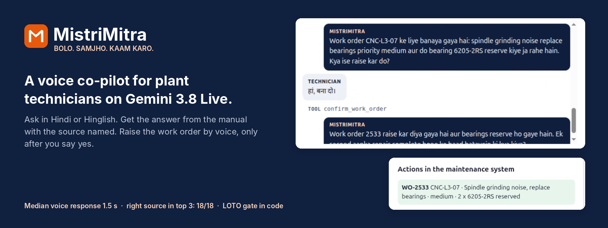
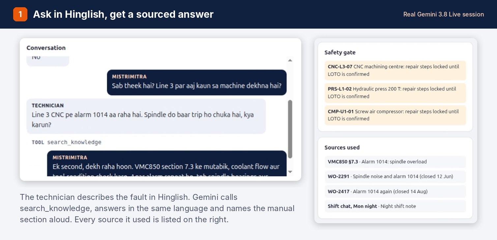
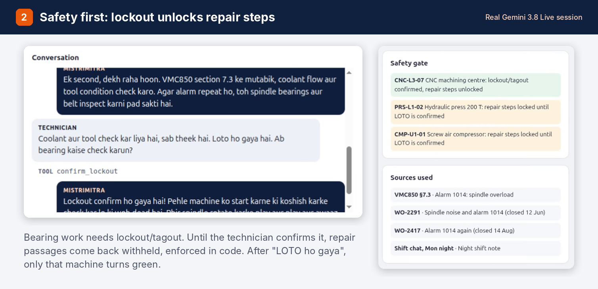
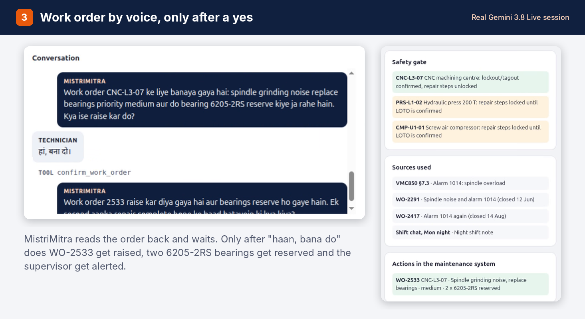

# MistriMitra



**Bolo. Samjho. Kaam karo.** A real-time voice co-pilot for plant maintenance technicians, built on **Gemini 3.8 Live**.

A technician on the shop floor says, in Hindi, Hinglish or their own language, _"Line 3 CNC pe alarm 1014 aa raha hai"_. MistriMitra searches the English machine manuals, SOPs, past work orders and shift chats, answers aloud in the same language with the source named, keeps the technician safe (no repair steps before lockout/tagout), and acts in the maintenance system: it raises the work order, reserves the spare and alerts the supervisor, but only after the technician says yes.

- **Try it:** https://profmohit-edu.github.io/mistrimitra/ (press "Run the scripted demo" with no key, or add a Gemini key and talk)
- **Watch it:** [2-minute demo video, real Gemini 3.8 Live session](https://drive.google.com/file/d/1KP0M0F-DeuB3Dj1LqJ-CnpPpWjFqIqN1/view)
- Track: Manufacturing Renaissance (BUILD 2036, TiE Global Summit)
- Author: Prof. Mohit Tiwari, Assistant Professor, Computer Science, Bharati Vidyapeeth's College of Engineering, New Delhi

## See it work

Screenshots from a real, unscripted Gemini 3.8 Live session in Hinglish.







## The problem

Indian MSME plants lose hours of machine time per breakdown because the fix lives in an English manual nobody reads on the floor, in a senior technician's head, or in last month's WhatsApp group. Technicians have greasy gloves and a noisy floor, so they need voice, in their own language. Downtime on a single CNC line costs about ₹20,000 an hour.

## What it does

| Step | What happens | Tool |
| --- | --- | --- |
| Diagnose | Searches manuals, SOPs, past work orders and shift chats; cites the section aloud | `search_knowledge`, `get_machine_history` |
| Stay safe | Repair steps are withheld in code until lockout/tagout is confirmed for that machine | `confirm_lockout` |
| Act | Checks the store, reads the work order back, raises it only after a spoken yes | `check_spare`, `propose_work_order`, `confirm_work_order` |
| Escalate | Alerts the supervisor on shift for high-priority faults | `notify_supervisor` |
| Learn | Asks "kya kiya?" after the job and saves the fix as a draft for supervisor review | `capture_fix` |

## Safety by design, enforced in code (not just in the prompt)

1. **Lockout gate.** Manual passages that need lockout/tagout come back as "repair steps withheld" until `confirm_lockout` is called for that exact machine (`src/knowledge.js`).
2. **Read-back rule.** `confirm_work_order` fails unless the technician has spoken after the proposal, so the model cannot propose and confirm in the same breath (`src/agent.js`).
3. **No invented values.** Answers must come from a search result; every source used is shown on screen.
4. **Human review.** Captured fixes are drafts until a supervisor approves them.

## Architecture

```
Microphone ─ AudioWorklet ─ 16 kHz PCM16 ─┐
                                          ├─ WebSocket ─ Gemini 3.8 Live (native audio, transcription,
Typed text ───────────────────────────────┘                 barge-in, tool calls in the background)
                                                                 │
                         tool calls ◄────────────────────────────┘
                              │
   search_knowledge (BM25 + Hinglish vocabulary, LOTO gate) · CMMS actions (work orders, spares,
   alerts, know-how drafts) · read-back rule
                              │
            24 kHz audio ─ gap-free player (stops on interruption) · live transcript · sources panel
```

- Static ES modules, no runtime dependencies, strict Content-Security-Policy (only `wss://generativelanguage.googleapis.com` is reachable).
- DOM built with a small XSS-safe builder; no `innerHTML`.
- The API key stays in the browser (session storage by default) and goes only to Google.
- The plant (Shakti Auto Components, Pune) and its manuals are fictional and were written for this demo. In production the knowledge base would be the plant's own manuals, embedded with Gemini embeddings, and the CMMS calls would go to SAP PM, Maximo or a Google Sheet.

## Run it

```bash
npm start            # serves on http://localhost:8080
```

Open the page, press **Gemini settings**, paste a Gemini API key from Google AI Studio, then **Start talking** (or type). **Run the scripted demo** works without a key: the lines are pre-written, but every tool call and safety rule runs for real.

## Quality and measured performance

```bash
npm install
npm run check        # ESLint (complexity ≤ 8), Prettier, TypeScript strict checkJs, 33 unit tests
npm run test:e2e     # Playwright: demo, fake Gemini Live socket, settings, reset, accessibility, phone layout
npm run bench        # retrieval benchmark
```

| Measure | Result |
| --- | --- |
| Voice response time, real Gemini 3.8 Live session (end of speech → first audio, 13 turns) | median 1.5 s, range 1.1–2.4 s |
| Retrieval, 18 English and Hinglish questions: right source in top 3 | 18 / 18 |
| Retrieval: right source ranked first | 16 / 18 |
| Retrieval time per query (in the browser, no server) | under 1 ms |
| Safety rules (LOTO gate, read-back before confirm) | enforced in code, covered by unit tests |

CI runs lint, formatting, type checks, unit and end-to-end tests on every push.

## Impact

If a voice co-pilot shortens the average diagnosis by 30 minutes on a plant with 20 breakdowns a month, that is about ₹2 lakh of machine time saved monthly per plant, and every fix captured makes the next one faster.

## License

MIT
